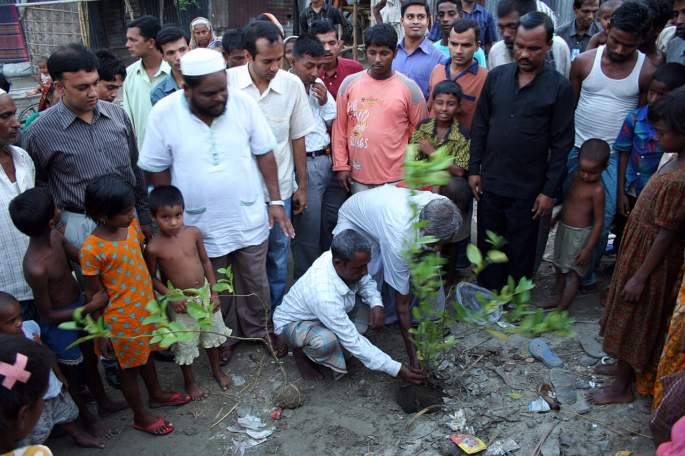

<div align="center">

# 🌿 ShobujBondhu

### Neighbours together. Communities stronger.

**A community-service events platform for local action across Bangladesh.**

<p>
  <a href="https://shobujbondhu-client.vercel.app">
    
  </a>
</p>

<p>
  <a href="https://github.com/HamimRaju/shobujbondhu-client">Client repository</a>
  &nbsp;·&nbsp;
  <a href="https://github.com/HamimRaju/shobujbondhu-server">API repository</a>
  &nbsp;·&nbsp;
  <a href="https://shobujbondhu-server.vercel.app/api/health">API health</a>
</p>

<p>
  
</p>

<p>
  
  
  
  
</p>

</div>

---

## A little action, close to home

ShobujBondhu helps neighbours find and organize community-service events, from clean-ups and tree planting to food and winter donations.

| 🔎 Discover | 🤝 Participate | 🌱 Organize |
| --- | --- | --- |
| Search upcoming events by location and category. | View details, join events, and keep your joined plans together. | Create, update, and manage your own community events. |

## Community in focus

<table>
  <tr>
    <td width="33%">
      
      <p align="center"><strong>Greener neighbourhoods</strong></p>
    </td>
    <td width="33%">
      
      <p align="center"><strong>Cleaner shared spaces</strong></p>
    </td>
    <td width="33%">
      
      <p align="center"><strong>Care for our coastline</strong></p>
    </td>
  </tr>
</table>

## Platform highlights

- Email/password authentication and optional Google sign-in.
- MongoDB-backed events: the home page shows the six soonest upcoming opportunities.
- Bangladesh-local event scheduling; past dates and times are rejected.
- JWT-protected event creation, joining, owner-only updates, and deletion.
- Personal joined-events dashboard, participant counts, and profile editing.
- Light/dark theme, responsive layouts, loading skeletons, search, and category filters.
- Public event APIs omit private creator identifiers; private API requests verify a JWT and its matching session.

## Built with

<p>
  <strong>Web</strong><br />
  Next.js App Router · React · TypeScript · Tailwind CSS
</p>
<p>
  <strong>Authentication</strong><br />
  Better Auth · Email/password · Google OAuth · JWT
</p>
<p>
  <strong>API and data</strong><br />
  Express · MongoDB · Zod · Helmet
</p>

## Get started

The client and API are separate packages with their own lockfiles. Run commands from the indicated directory.

### 1. Install dependencies

```bash
cd shobujbondhu-server && npm install
cd ../shobujbondhu-client && npm install
```

### 2. Configure the API

```bash
cd shobujbondhu-server
cp .env.example .env
```

Set `MONGODB_URI`, `DB_NAME`, and a random `BETTER_AUTH_SECRET` of at least 32 characters. For local development:

```dotenv
BETTER_AUTH_URL=http://localhost:5000
CLIENT_URL=http://localhost:3000
```

Google sign-in is optional. Set both `GOOGLE_CLIENT_ID` and `GOOGLE_CLIENT_SECRET` and allow this callback:

```text
http://localhost:5000/api/auth/callback/google
```

### 3. Configure the client

```bash
cd ../shobujbondhu-client
cp .env.example .env.local
```

Set `NEXT_PUBLIC_BETTER_AUTH_URL=http://localhost:5000` and `NEXT_PUBLIC_SITE_URL=http://localhost:3000`.

### 4. Start the two services

Run each command in a separate terminal:

```bash
# shobujbondhu-server
npm run dev
```

```bash
# shobujbondhu-client
npm run dev
```

Open [http://localhost:3000](http://localhost:3000). The API listens on port `5000`.

## Checks

```bash
# Client
cd shobujbondhu-client
npm run lint
npm run build

# API
cd ../shobujbondhu-server
npm run typecheck
npm test
npm run build
```

Run only the server event-validator tests with:

```bash
cd shobujbondhu-server
npx tsx --test src/tests/event.validator.test.ts
```

## Production setup

The [client](https://shobujbondhu-client.vercel.app) and [Express API](https://shobujbondhu-server.vercel.app) are deployed on Vercel. Keep `BETTER_AUTH_URL`, `CLIENT_URL`, `CORS_ORIGINS`, `NEXT_PUBLIC_BETTER_AUTH_URL`, and `NEXT_PUBLIC_SITE_URL` aligned with the deployed origins. Use HTTPS and set the Google Cloud authorized callback to:

```text
https://shobujbondhu-server.vercel.app/api/auth/callback/google
```
